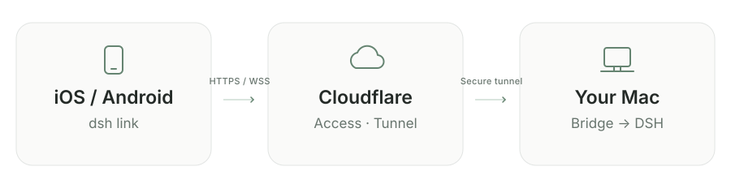

# dsh link

[简体中文](README.md) · **English**

Continue your Mac's DSH conversations on iPhone and iPad.

`unofficial` · `self-hosted` · `iOS 17+` · `SwiftUI` · `MIT`


**An unofficial iOS client and macOS bridge for personal, self-hosted use.** Tasks, model calls, and file operations run on your Mac. Use your phone to send messages and images, follow progress, approve actions, and answer questions. DeepSeek Harness must be installed and signed in on your Mac. This repository does not include the DSH desktop app.

> **Public beta** — [Install dsh link with TestFlight](https://testflight.apple.com/join/KqMhXcHS)
>
> Install TestFlight on your iPhone or iPad, then open the link to join. You still need to set up the Mac bridge and connection as described below.

## Contents

- [Features](#features)
- [How it connects](#how-it-connects)
- [Requirements](#requirements)
- [Let an AI help you set up](#let-an-ai-help-you-set-up)
- [Quick start](#quick-start)
  - [A. Own domain (recommended)](#a-own-domain-recommended-tunnel--access)
  - [B. No domain: Quick Tunnel](#b-no-domain-quick-tunnel)
- [Run at login and check connectivity](#run-at-login-and-check-connectivity)
- [Development and verification](#development-and-verification)
- [Security and intended use](#security-and-intended-use)

## Features

- **SwiftUI interface** — Follows the system's light or dark appearance. Switch between conversations and workspaces in the sidebar, using the same DSH backend as the desktop app.
- **Adaptive iPad layout** — Workspace/conversation sidebar and chat pane on wide windows. Narrow windows use a drawer. Rotation preserves the active chat and unsent draft.
- **Workspaces and archive** — Expand or collapse conversations by desktop workspace. Group the conversation list by workspace or date. Archive conversations from their menu and restore them from **Archived**; changes sync with the desktop app.
- **Streaming and Markdown** — Streaming replies, collapsible thinking and tool activity, Markdown, and horizontally scrollable tables.
- **Images and local cache** — Image uploads and previews. Conversation history is cached locally, separated by server and conversation.
- **Approvals and push** — Action approvals, questions, permission selection, and optional APNs notifications.
- **Two connection modes** — Cloudflare Access with your own domain, or Quick Tunnel without a domain. Enter credentials manually or scan a QR code on your Mac. Credentials stay in the device's Keychain; neither the source nor the app contains preconfigured credentials.
- **Companion tooling** — Includes the Mac bridge, installation and diagnostic scripts, and an AI-assisted setup guide.

  

## How it connects

### Which mode

| Scenario | Choose |
| --- | --- |
| Daily use, long-term remote access | **Own domain + Tunnel + Access (recommended)** |
| No domain, try it first | **Quick Tunnel (temporary)** |

**For everyday use, we recommend your own domain with Cloudflare Tunnel + Access.** Once the phone has saved the fixed address and a valid Service Token, normal bridge or tunnel restarts do not require another scan. You can run the services at login and issue, renew, or revoke a separate token for each device. Quick Tunnel is available for trying the app without a domain.

| Comparison | Own domain + Tunnel + Access (recommended) | Quick Tunnel (temporary use) |
| --- | --- | --- |
| Prerequisites | Your Cloudflare account, a domain managed there, and Zero Trust / Access | No Cloudflare account or domain |
| Phone configuration | Fixed HTTPS address and Service Token Client ID / Client Secret; QR pairing supported | Temporary HTTPS address and 64-character connection key; QR pairing supported |
| Restarts and background operation | Keep the hostname and valid credentials; supports running at login | Keep the terminal running; scan again after every restart |
| Multiple iPhones / iPads | Can connect to the same Mac; separate Service Tokens per device are recommended | Can connect to the same Mac; devices share this run's connection key |
| Revoking a device | Revoke its token; restart the bridge if needed to close existing connections | Stop and restart; all devices must scan again |
| Push notifications | Optional APNs with separate setup | APNs is not enabled |
| Intended use | Daily, long-term remote access | Trying the app without a domain and temporary testing |

The domain option provides a stable entry point and easier device management. Your Mac must still be awake, online, and running DSH; this does not guarantee access while it is asleep or offline. Quick Tunnel has no uptime guarantee, so use the domain option for ongoing access.

> **Quick Tunnel is available starting with build 1.0 (8), which is open for external testing. Install or update using the TestFlight link above. If the settings page has no “Quick Tunnel” option, check that you have build 1.0 (8) or later. Building from source is also supported.** Both modes use HTTPS/WSS and authenticate requests at the Mac bridge. Quick Tunnel uses an independent connection key.

The diagram shows the recommended Tunnel + Access setup. Follow **A. Own domain (recommended)** below, or choose **B. No domain** to try Quick Tunnel.

<picture>
  <source media="(prefers-color-scheme: dark)" srcset="docs/images/connection-dark-en.svg">
  
</picture>

Cloudflare Access validates the phone's Service Token at the edge. The Mac bridge then validates the JWT signature, issuer, application audience (AUD), and expiry before using the **current Mac user's** local DSH browser-session credentials to reach the desktop app. The bridge discovers DSH's random port automatically.

The `bridge/` directory is the companion DSH “plugin.” It runs as a separate process: **you do not need to place files in the DSH installation or modify `app.asar`**. It relies on internal DSH RPC, event, and authentication formats, so DSH updates may require changes to this project. There is no official compatibility guarantee. The desktop version checked for this project is `0.2.1-rc.2` on macOS.

## Requirements

| Component | Requirement |
| --- | --- |
| Mac | DeepSeek Harness installed, running, signed in, with at least one usable conversation |
| iPhone / iPad | iOS / iPadOS 17 or later |
| Xcode | Version 16 or later; the current project was built with Xcode 27.1 |
| Node.js | Version 22 or later; current LTS recommended, including npm |
| Python | Python 3 for setup, service management, and security scripts |
| cloudflared | A version supporting `--token-file`, at least `2025.4.0` |
| Cloudflare | Quick Tunnel needs no account or domain; Access mode needs your own account, domain, and Zero Trust / Access |
| Apple signing | Your own Apple account/Team for source builds on a device; APNs is optional and needs the appropriate signing capability |

> **Your Mac must stay awake, online, and running DSH.** The phone does not need cloudflared, and no inbound port needs to be exposed on the Mac.

## Let an AI help you set up

Clone this repository on your Mac and open it with an AI assistant that can access local files and a terminal. **We recommend the domain option. Once you have your domain ready, use this prompt:**

> Read this repository's AGENTS.md, docs/ai-setup.md, and docs/cloudflare.md, and help me set up dsh link. First inspect DSH, Node.js, Xcode, and cloudflared on this Mac. My target hostname is `<your hostname>`. Create a dedicated Tunnel, Access application, and Service Auth policy using the Cloudflare account and domain I explicitly select. Read sensitive credentials from private files outside the repository or secure input. Do not print them, put them in source code, or commit them to Git. Configure the bridge, tunnel, and iOS build settings. Then verify that unauthenticated requests are rejected and authenticated RPC and WebSocket connections work. Finally, tell me which fields to fill in on the phone and where the private configuration files are stored.

**To try Quick Tunnel without a domain, use this prompt:**

> Read AGENTS.md, the Quick Tunnel section of README.en.md, and docs/ai-setup.md. Help me configure dsh link using domain-free Quick Tunnel. Check DSH, Node, cloudflared, and Xcode command-line tools on my Mac. Install bridge dependencies and run npm run quick --prefix bridge to show the local pairing QR code. Preserve any existing domain connection. Do not create Cloudflare accounts, domains, Access applications, or Tunnel Tokens. Do not print or save the connection key. Verify that missing and incorrect keys are rejected and authenticated HTTP RPC and WebSocket connections succeed. Then build the iOS client with Quick Tunnel support and explain how to scan the code and stop the temporary connection.

The AI can handle local installation, file generation, diagnostics, and authorized Cloudflare changes. Cloudflare/Apple sign-in, account selection, payments, and trusting a developer on the phone may still require you to act.

> **A successful build alone does not prove the connection works.**

The detailed deployment guides linked below are currently in Chinese; the AI can read them as part of this workflow.

## Quick start

Clone the project if you have access to the repository, or after it becomes public. Run subsequent commands from the repository root:

```bash
git clone https://github.com/msly5/dsh-link.git
cd dsh-link
npm ci --ignore-scripts --prefix bridge
```

In Access mode, `bootstrap.py` only checks tools and creates a template at `~/.config/dsh-remote/bridge.env`. It does not create cloud resources, start services, or overwrite existing configuration. To use another private directory, set `DSH_REMOTE_CONFIG_DIR=/absolute/path`; the other scripts use the same variable.

The project is now called **dsh link**. To keep existing clients and Mac services working, it retains the `DSHRemote` Xcode project, existing Bundle ID, `dshremote://` pairing links, `DSH_REMOTE_CONFIG_DIR`, and private configuration directory. The name change does not require you to re-enter connection credentials.

### A. Own domain (recommended): Tunnel + Access

Recommended for daily, long-term remote access. First prepare the private configuration template:

```bash
python3 scripts/bootstrap.py
```

1. **Configure Cloudflare** — Follow the [Cloudflare setup guide](docs/cloudflare.md) to create a dedicated Service Token, Access application, Tunnel, and hostname route.
2. **Configure the Mac bridge** — Set the Team Domain and application AUD in `bridge.env` outside the repository.
3. **Check and start the local services**

```bash
npm run doctor --prefix bridge
npm start --prefix bridge
# In another terminal, still from the repository root:
sh scripts/run-tunnel.sh
```

4. **Build the iOS client from source**

```bash
cp config/Local.example.xcconfig config/Local.xcconfig
open DSHRemote.xcodeproj
```

Set your unique Bundle ID and `DEVELOPMENT_TEAM` in `config/Local.xcconfig`, or select your Team in Xcode's Signing & Capabilities settings. Choose the `DSHRemote` scheme and your iPhone or iPad, then click Run. APNs is disabled by default; push notifications are not required for ordinary use. If you installed through TestFlight, skip this source-build step.

5. **Configure the phone** — Enter your HTTPS server address, such as `https://dsh.example.com`, and the Service Token's Client ID and Client Secret. Tap **Test connection** (测试连接), then **Save** (保存). Testing does not save the draft; saving or clearing the connection updates the local Keychain. Keychain data may survive uninstalling the app. To remove it, first use **Clear saved connection** (清除已保存的连接) in settings.

#### QR pairing

On the Mac, first save the phone's Service Token using hidden input, then display the local pairing code:

```bash
python3 scripts/store-secret.py client  # Skip if client.json already exists
npm run pair --prefix bridge
```

On the phone, open **Connection settings → Scan Mac connection QR code** (连接设置 → 扫描 Mac 连接二维码), or scan it with the system Camera app. The server and credentials are filled in automatically. Confirm the server, then tap **Save**. Manual entry remains available if camera permission is denied. The Mac window closes after five minutes, and the app rejects expired pairing codes.

> **Treat the QR code as a credential.** It is generated locally in memory using macOS Core Image. It does not open a web page, call an external QR service, or print credentials. It contains the complete Service Token: **do not screenshot, share, or commit it**. Expiry only prevents importing the code; it does not revoke the token. Revoke a leaked token in Cloudflare. To check local generation and recognition without displaying the code, run `npm run pair --prefix bridge -- --check`.

Do not enter a Cloudflare API Token, Tunnel Token, or DSH sign-in secret on the phone. The phone only needs the two **Service Token** credentials.

### B. No domain: Quick Tunnel

1. Open DSH on your Mac and sign in. Keep the Mac online. From the repository root, run the command below. If tools are missing and you have Homebrew, first run `brew install node cloudflared`.

```bash
npm run quick --prefix bridge
```

2. The command starts a separate loopback bridge (default `127.0.0.1:3080`) and cloudflared, obtains a random `https://….trycloudflare.com` address, and opens a local QR window. It checks public rejection of missing/incorrect keys and authenticated HTTP RPC and WebSocket connectivity. Results contain no conversations or credentials.
3. Install build 1.0 (8) or later using the TestFlight link above, or build from source using step 4 under A. On the phone, choose **Connection settings → Scan Mac connection QR code**. Scanning selects **Quick Tunnel** and fills in the server and connection key. Tap **Test connection**, then **Save**. No Client ID or Client Secret is needed.
4. For manual entry, click **查看手动连接信息** in the Mac QR window. Select **Quick Tunnel** on the phone and enter the HTTPS address and 64-character connection key. The QR window closes after five minutes; type `p` and press Return in the running terminal to reopen it, or `r` to recheck public connectivity.
5. Keep the terminal running. Press **Ctrl+C** to stop this bridge and tunnel. Every launch generates a new address and key, so scan again after restarting. The key stays in Mac process memory, the local QR window, and the phone's Keychain; it is never written to configuration files or logs.

#### Quick Tunnel notes and limits

The five-minute QR expiry only limits importing the code. It does not disconnect an already connected phone. Closing the QR window does not stop the tunnel; use Ctrl+C in the running terminal to end it. The app currently saves one connection profile at a time. Save the corresponding new profile when changing mode or server.

APNs push is not enabled in Quick Tunnel mode. Quick Tunnel needs no `tunnel.token`, `client.json`, Team Domain, or AUD. Do not run `scripts/run-tunnel.sh` or install LaunchAgents for this mode. It runs separately from an existing Access connection. If port 3080 is occupied, use `DSH_QUICK_PORT=3081 npm run quick --prefix bridge`; no existing service is stopped.

Underneath, it runs `cloudflared tunnel --config /dev/null --url http://127.0.0.1:3080`, ignoring existing cloudflared configuration without modifying it. This project's bridge adds a random 256-bit key to authenticate both HTTP and WebSocket requests. Do not point a tunnel directly at DSH's random port. If a key leaks, stop and restart Quick Tunnel to invalidate the old address, key, and open connections.

Quick Tunnels are temporary, have no uptime guarantee, change hostname on recreation, and do not support SSE. This client receives events over WebSocket. Do not add `--allowed-mail`: its interactive browser sign-in does not work with this client. If the initial check fails, verify that your network and DNS can reach `trycloudflare.com`, then enter `r` to retry. A failed check does not mean the connection works. Use the recommended Access setup above for a stable address. See [Cloudflare's Quick Tunnels documentation](https://developers.cloudflare.com/tunnel/get-started/quick-tunnels/).

## Run at login and check connectivity

This section is for Access mode with your own domain. Quick Tunnel runs in the foreground using the command above.

### Install LaunchAgents

After confirming that manual startup works, stop the foreground bridge and cloudflared processes, then run:

```bash
python3 scripts/service.py install
```

This installs two LaunchAgents for the current user: `app.dshremote.bridge` and `app.dshremote.tunnel`. They reference this repository's absolute path. Uninstall and reinstall them if you move the checkout. They start when you sign in to your Mac; connectivity is not guaranteed while the Mac is asleep or you are signed out. Logs stay in the private configuration directory and do not contain request content or credentials. DSH's own login items are not modified.

```bash
python3 scripts/service.py uninstall
```

### Public connectivity probe

For an automated public-endpoint connection check, first save optional local probe credentials using hidden input:

```bash
python3 scripts/store-secret.py client
node bridge/src/probe.mjs
```

The probe checks that unauthenticated requests are denied, authenticated HTTP RPC succeeds, and the WebSocket receives a DSH ready frame. It does not print conversation content or credentials. Enter the credentials manually on the phone, or generate a pairing code from this private `client.json`. You can delete the private file when you no longer need probing or pairing; this does not affect credentials already saved in the phone's Keychain.

## Development and verification

```bash
swift test
npm ci --ignore-scripts --prefix bridge
npm test --prefix bridge
python3 -m unittest discover -s scripts/tests
python3 scripts/check-secrets.py
xcodebuild -project DSHRemote.xcodeproj -scheme DSHRemote \
  -destination 'generic/platform=iOS Simulator' CODE_SIGNING_ALLOWED=NO build
```

The Swift package runs macOS unit tests for the protocol, conversation cache, images, execution history, and connection profiles. iOS UI behavior requires Xcode builds and simulator or device testing. Bridge tests cover JWT rejection, HTTP/WS forwarding, and authentication-header isolation. CI checks and builds the source; it does not deploy your Cloudflare resources.

### Repository layout

| Path | Contents |
| --- | --- |
| `DSHRemote/` | Native SwiftUI client, Keychain storage, RPC, and conversation cache |
| `DSHRemote.xcodeproj/` | iOS project and shared scheme |
| `bridge/` | Mac bridge, Access JWT validation, and optional APNs listener |
| `config/` | Generic signing configuration and example push entitlements |
| `scripts/` | Private configuration setup, hidden input, LaunchAgents, and release checks |
| `docs/cloudflare.md` | Step-by-step Cloudflare setup and troubleshooting |
| `docs/ai-setup.md` | AI-assisted deployment workflow and acceptance criteria |
| `docs/push.md` | Optional APNs setup |
| `SECURITY.md` | Trust boundaries, credential handling, and vulnerability reporting |

## Security and intended use

A connected phone can operate your DSH sessions, which may execute commands or access files on the Mac. Only configure Service Tokens on devices you trust. Issue separate tokens per device, renew them periodically, and revoke tokens for lost devices. This project is intended for personal self-hosting; it is not a service with isolated user accounts.

The client sends credentials only to the configured HTTPS server and rejects automatic redirects. The bridge listens only on loopback. Access mode validates Access JWTs for both HTTP and WebSocket requests; Quick Tunnel mode validates the independent connection key for both. There is no unauthenticated mode. In Access mode, protect the remote hostname with a correctly configured application; do not use a Bypass or Everyone policy.

Local conversation and image caches contain conversation content. They stay in the app sandbox and are separated by server and conversation. They are not a cloud backup; if the cache is lost, the app reloads data from the same DSH backend. Push notifications are disabled by default. When enabled, lock-screen notifications show only generic approval or question prompts. See [SECURITY.md](SECURITY.md) for more information.

---

This repository uses the MIT license. See [THIRD_PARTY_NOTICES.md](THIRD_PARTY_NOTICES.md) for information about DSH software, trademarks, and third-party dependencies.
