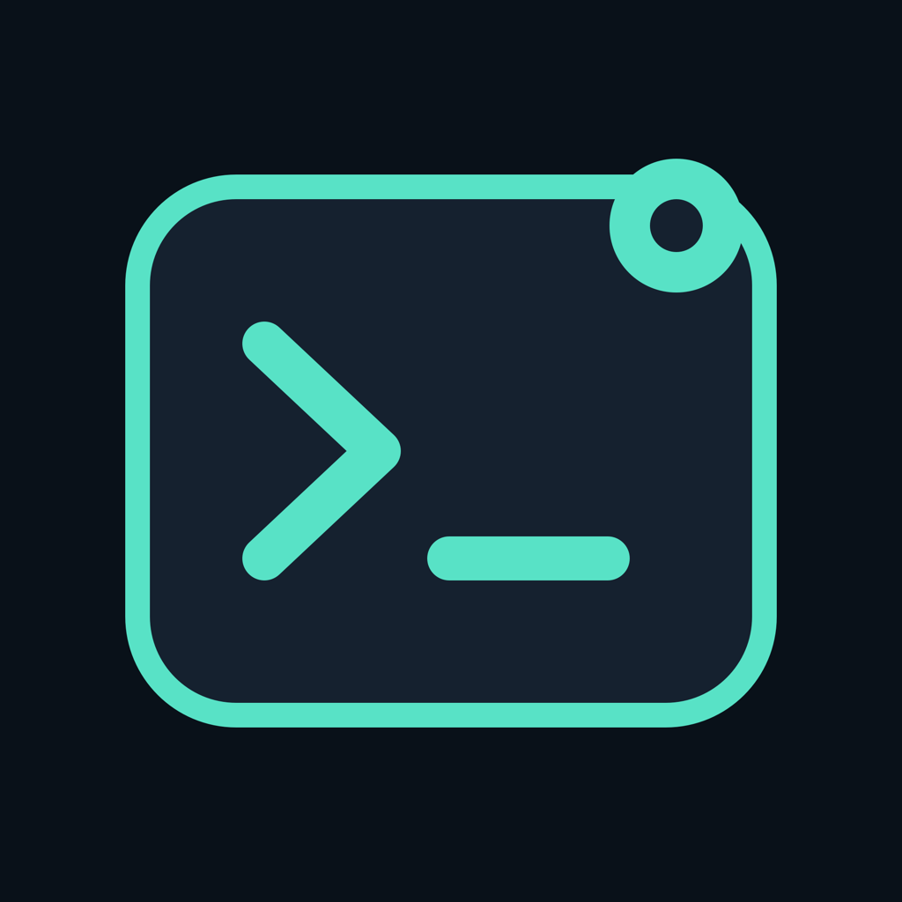
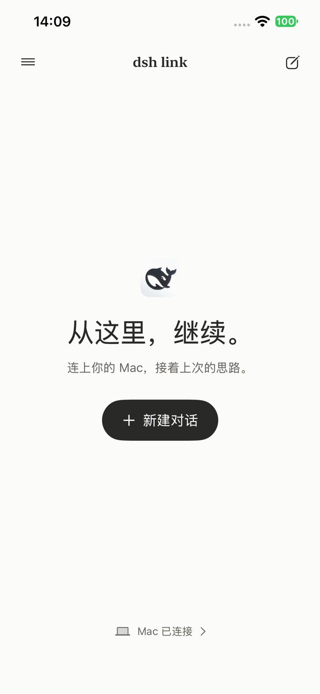
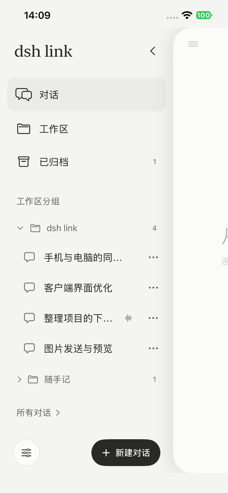
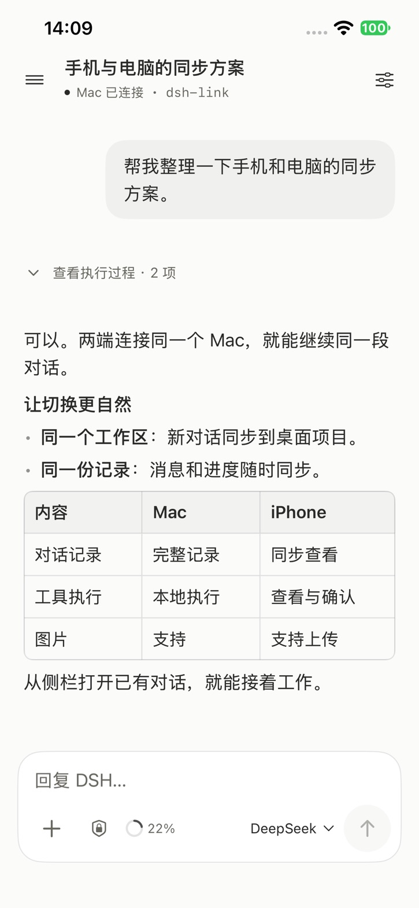
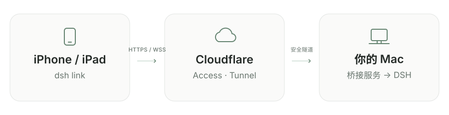

# dsh link

**简体中文** · [English](README.en.md)

在 iPhone 和 iPad 上继续 Mac 里的 DSH 会话。

**非官方、面向个人自托管的 iOS 客户端与 macOS 桥接服务。** 任务、模型调用和文件操作都在 Mac 上完成；手机用于发消息、发送图片、查看执行进度、处理审批和回答问题。需要自行安装并登录 DeepSeek Harness 桌面端。本仓库不包含 DSH 桌面软件。



**公开测试：[通过 TestFlight 安装 dsh link](https://testflight.apple.com/join/KqMhXcHS)**

iPhone / iPad 先安装 TestFlight，再打开链接加入测试。Mac 桥接与连接配置仍需按下文完成。

- 简洁的 SwiftUI 界面，自动跟随系统浅色 / 深色外观；侧栏切换最近对话与工作区，与桌面端共用同一个 DSH 后端。
- iPad 宽屏使用工作区 / 会话侧栏与聊天双栏，支持横竖屏；窄窗口自动切换抽屉侧栏，旋转保留当前聊天和输入草稿。
- 侧栏按桌面工作区展开 / 收起会话；对话列表可按工作区或时间分组。会话菜单支持归档，侧栏“已归档”可查看和恢复，状态同步到桌面端。
- 流式回复、可折叠的思考与工具执行记录、Markdown、可横向滚动的完整表格。
- 图片上传与查看；会话历史在设备本地缓存，按服务器和会话分隔。
- 会话审批、提问及权限选择；可选 APNs 通知。
- 支持有域名的 Cloudflare Access 和免域名的 Quick Tunnel；可手动填写或扫描 Mac 二维码导入连接；凭证保存在设备 Keychain，源码和 App 内没有预置凭证。
- 自带 Mac 端桥接、安装/诊断脚本和 AI 配置指南。

  

## 连接方式

**推荐长期使用「自己的域名 + Cloudflare Tunnel + Access」。** 手机保存固定地址和有效的 Service Token 后，Mac 桥接或隧道正常重启无需重新扫码；可设置登录后自动运行，也能给每台设备单独发放、续期和撤销令牌。没有域名、想先体验时，可以使用 Quick Tunnel。

| 对比项 | 域名 + Tunnel + Access（推荐） | Quick Tunnel（临时体验） |
| --- | --- | --- |
| 准备条件 | 自己的 Cloudflare 账户、接入的域名、Zero Trust / Access | 不需要 Cloudflare 账户或域名 |
| 手机填写 | 固定 HTTPS 地址、Service Token 的 Client ID / Client Secret；支持扫码 | 临时 HTTPS 地址、64 位连接密钥；支持扫码 |
| 重启与后台运行 | 保留域名和有效凭证即可继续连接；支持登录后自动运行 | 终端需保持运行，每次重新启动都要重新扫码 |
| 多台 iPhone / iPad | 可以连接同一 Mac，推荐每台设备使用独立 Service Token | 可以连接同一 Mac，本次运行的设备共用连接密钥 |
| 撤销某台设备 | 撤销其独立 Service Token；必要时重启桥接断开旧连接 | 需停止并重启，所有设备重新扫码 |
| 推送通知 | 可选 APNs，需单独配置 | 当前未启用 APNs |
| 适用场景 | 日常使用、长期远程连接 | 无域名试用、临时测试 |

域名方式提供固定入口和更方便的设备管理；Mac 仍需保持开机、联网且 DSH 正在运行，不能保证 Mac 睡眠或离线时可连接。Quick Tunnel 的临时地址没有可用性保证，长期使用建议切换到域名方式。

**Quick Tunnel 已在本仓库源码中实现。当前 TestFlight 构建 1.0 (7) 尚未包含该功能；请先从源码构建包含“Quick Tunnel”选项的客户端。** 两种方式都使用 HTTPS/WSS，Mac 桥接都验证凭证；Quick Tunnel 的独立连接密钥不依赖 Access。

下图为推荐的 Tunnel + Access 模式。按下方快速开始中的 **A. 域名方式（推荐）** 配置；没有域名时选择 **B. 无域名方式**。

<picture>
  <source media="(prefers-color-scheme: dark)" srcset="docs/images/connection-dark.svg">
  
</picture>

Access 在 Cloudflare 边缘验证手机的 Service Token。Mac 桥接再次验证 JWT 签名、签发者、应用 AUD 和有效期，再读取**当前 Mac 用户**的 DSH 浏览器会话凭证访问桌面端。DSH 的随机端口会自动发现。

`bridge/` 就是 DSH 侧的配套“插件”：它作为独立进程运行，**无需往 DSH 安装目录放文件或修改 app.asar**。它依赖桌面端内部 RPC、事件和认证格式，DSH 更新后可能需要适配；本项目没有官方兼容性承诺。已核对的桌面版本：`0.2.1-rc.2`，macOS。

## 环境要求

| 项目 | 要求 |
| --- | --- |
| Mac | 已安装并运行 DeepSeek Harness，已登录，已有一个可用会话 |
| iPhone / iPad | iOS / iPadOS 17 或更新版本 |
| Xcode | 16 或更新版本；当前整理版本用 Xcode 27.1 构建验证 |
| Node.js | 22 或更新版本，推荐当前 LTS；包含 npm |
| Python | Python 3，供配置/服务/安全检查脚本使用 |
| cloudflared | 支持 `--token-file` 的版本，至少 `2025.4.0` |
| Cloudflare | Quick Tunnel 无需账户或域名；Access 模式需要自己的账户、域名及 Zero Trust / Access |
| Apple 签名 | 真机安装需自己的 Apple 账号/Team；APNs 为可选项，需对应推送能力 |

Mac 必须保持开机、联网且 DSH 桌面端在运行。手机不需要安装 cloudflared，也不需要暴露 Mac 入站端口。

## 让 AI 帮你配置

把这个仓库拉到 Mac，用能访问本机文件和终端的 AI 打开。**推荐域名方式，准备好自己的域名后使用以下指令：**

> 请阅读此仓库的 AGENTS.md、docs/ai-setup.md 和 docs/cloudflare.md，帮我配置 dsh link。先检查 Mac 上的 DSH、Node、Xcode 和 cloudflared。我的目标域名是 `<你的域名>`。新建独立的 Tunnel、Access 应用和 Service Auth 策略，使用我明确指定的 Cloudflare 账户和域名。敏感凭证从仓库外的私有文件或安全输入读取，不回显、不写进源码、不提交 Git。完成桥接、隧道和 iOS 构建配置后，分别验证无凭证被拒绝、带凭证的 RPC 与 WebSocket 正常，最后告诉我手机需要填写的字段和私有文件位置。

**没有域名、仅先体验 Quick Tunnel 时，使用以下指令：**

> 请阅读此仓库的 AGENTS.md、README.md 中的 Quick Tunnel 部分和 docs/ai-setup.md，帮我用免域名的 Quick Tunnel 配置 dsh link。检查 Mac 上的 DSH、Node、cloudflared 和 Xcode 命令行工具，安装 bridge 依赖，运行 npm run quick --prefix bridge，显示本地连接二维码。保留已有域名连接，不创建 Cloudflare 账户、域名、Access 或 Tunnel Token，不输出或保存连接密钥。验证公网无密钥与错误密钥被拒绝、正确凭证的 HTTP 与 WebSocket 可用，再帮我构建支持 Quick Tunnel 的 iOS 客户端。告诉我手机如何扫码和停止临时连接。

AI 能自动完成本地安装、文件生成、诊断及已授权的 Cloudflare 操作。Cloudflare/Apple 登录、账户选择、付款、手机信任开发者等交互可能仍需你本人完成。**不能仅凭构建成功就宣称已连通。**

## 快速开始

有仓库访问权限时（或后续公开后），克隆项目。后续命令均在仓库根目录执行：

```bash
git clone https://github.com/msly5/dsh-link.git
cd dsh-link
npm ci --ignore-scripts --prefix bridge
```

Access 模式下使用的 `bootstrap.py` 只检查工具并在 `~/.config/dsh-remote/bridge.env` 创建模板，不创建云资源、不启动服务，也不会覆盖现有配置。自定义私有目录时可设 `DSH_REMOTE_CONFIG_DIR=/绝对路径`，后续脚本会复用它。

项目现名为 **dsh link**。为兼容已安装的客户端和 Mac 服务，Xcode 工程 `DSHRemote`、既有 Bundle ID、`dshremote://` 扫码链接、`DSH_REMOTE_CONFIG_DIR` 和私有配置目录继续沿用原标识；改名不要求重新填写连接凭证。

### A. 域名方式（推荐）：Tunnel + Access

推荐用于日常与长期远程连接。先准备私有配置模板：

```bash
python3 scripts/bootstrap.py
```

1. **先配 Cloudflare**：按 [完整 Cloudflare 配置](docs/cloudflare.md) 创建专用 Service Token、Access 应用、Tunnel 和域名路由。
2. **配置 Mac 桥接**：在仓库外的 `bridge.env` 填入 Team Domain 和应用 AUD。
3. **本机检查并启动**：

```bash
npm run doctor --prefix bridge
npm start --prefix bridge
# 另开一个终端，仍在仓库根目录：
sh scripts/run-tunnel.sh
```

4. **构建手机端**：

```bash
cp config/Local.example.xcconfig config/Local.xcconfig
open DSHRemote.xcodeproj
```

在 `config/Local.xcconfig` 设置自己的唯一 Bundle ID 和 `DEVELOPMENT_TEAM`，或在 Xcode 的 Signing & Capabilities 中选择自己的 Team。选择 `DSHRemote` scheme 和 iPhone / iPad，点击 Run。默认关闭 APNs，普通使用无需配置推送。若通过 TestFlight 安装，可跳过源码构建这一步。

5. **手机连接设置**：填写 `https://dsh.你的域名`、该 Service Token 的 Client ID、Client Secret，先“测试连接”，再“保存”。测试不会保存草稿；保存或清除操作作用于本机 Keychain。Keychain 数据可能在卸载 App 后仍保留，需要移除时先用设置页“清除已保存的连接”。

也可以**扫码配置**。先在 Mac 用隐藏输入保存手机专用的 Service Token，再显示本地二维码：

```bash
python3 scripts/store-secret.py client  # 已有 client.json 时跳过
npm run pair --prefix bridge
```

iPhone 打开 **连接设置 → 扫描 Mac 连接二维码**，或用系统相机扫码打开 App。服务器与凭证会自动填入；确认服务器后点“保存”即可连接。拒绝相机权限时仍可手动填写。Mac 窗口 5 分钟后关闭，App 拒绝过期的二维码。

二维码由 macOS 原生 Core Image 在本机内存生成，不启动网页、不请求外部二维码服务、不打印凭证。它包含完整 Service Token，等同凭证，**不要截图、分享或提交到仓库**。过期只限制 App 导入，不会撤销 Token；如泄露，需在 Cloudflare 撤销。可运行 `npm run pair --prefix bridge -- --check` 验证二维码本地生成与识别，不显示二维码。

不要把 Cloudflare API Token、Tunnel Token 或 DSH 登录密钥填到手机上。手机只需要 **Service Token** 的两项凭证。

### B. 无域名方式：Quick Tunnel

1. 打开并登录 Mac 上的 DSH，保持 Mac 联网。在仓库根目录运行（缺少工具且已安装 Homebrew 时，先执行 `brew install node cloudflared`）：

```bash
npm run quick --prefix bridge
```

2. 命令会启动独立的本机桥接（默认 `127.0.0.1:3080`）和 cloudflared，获取随机的 `https://….trycloudflare.com` 地址，自动显示 Mac 本地二维码。它会检查公网无密钥/错误密钥被拒绝，以及认证 HTTP RPC 和 WebSocket 连通情况；终端只报告结果，不打印会话或密钥。
3. 使用包含本功能的 iOS 源码构建（构建方式见上方 A 的第 4 步）。手机打开 **连接设置 → 扫描 Mac 连接二维码**，扫码会自动选择 **Quick Tunnel**，填入服务器和连接密钥；点“测试连接”，再“保存”。无需填写 Client ID / Client Secret。
4. 无法扫码时，在 Mac 二维码窗口点 **查看手动连接信息**；手机选择 **Quick Tunnel**，填写该 HTTPS 地址与 64 位连接密钥。二维码 5 分钟后关闭，在运行命令的终端输入 `p` 并回车可以重新显示；输入 `r` 并回车可重新检查公网连接。
5. 保持终端运行；按 **Ctrl+C** 停止本次桥接与隧道。每次启动都会生成新地址和新密钥，手机需重新扫码。密钥只存在 Mac 进程内存、二维码窗口和手机 Keychain，不写入配置文件或日志。

二维码的 5 分钟有效期只限制导入，不会在 5 分钟后自动断开已连接的手机；关闭二维码窗口也不会停止隧道。要结束连接，应在运行命令的终端按 Ctrl+C。App 当前一次保存一份连接配置；切换连接方式或服务器时需保存对应的新配置。

Quick Tunnel 模式暂不启用 APNs 推送。Quick Tunnel 不使用 `tunnel.token`、`client.json`、Team Domain 或 AUD，也不需要运行 `scripts/run-tunnel.sh` 或安装 LaunchAgent。它与原有 Access 模式分开运行；若 3080 已被占用，改用 `DSH_QUICK_PORT=3081 npm run quick --prefix bridge`，命令不会关闭其他服务。

底层使用 `cloudflared tunnel --config /dev/null --url http://127.0.0.1:3080`，忽略已有 cloudflared 配置而不修改它，本项目在桥接层增加随机 256 位密钥鉴权，同时保护 HTTP 和 WebSocket。不要把 Tunnel 直接指向 DSH 的随机端口。密钥泄露时，停止并重新运行 Quick Tunnel，让旧地址、旧密钥和已有连接失效。

Quick Tunnel 面向临时测试，没有可用性保证；重建隧道后地址会变化，且不支持 SSE。本客户端使用 WebSocket 接收事件。不要添加 `--allowed-mail`：其交互式浏览器登录不适用于本客户端。若首次检查失败，确认网络和 DNS 能访问 `trycloudflare.com`，稍后输入 `r` 重试；失败提示不代表已连通。长期固定地址请使用上方推荐的 Access 模式。参考 [Cloudflare Quick Tunnels 官方说明](https://developers.cloudflare.com/tunnel/get-started/quick-tunnels/)。

## 常驻运行与连通检查

本节用于有域名的 Access 模式。Quick Tunnel 使用上方前台命令，随时停止和重新扫码。

手动启动确认正常后，退出前台 bridge / cloudflared，再运行：

```bash
python3 scripts/service.py install
```

安装两个当前用户的 LaunchAgent：`app.dshremote.bridge`、`app.dshremote.tunnel`。它们引用当前仓库的绝对路径，移动仓库后需卸载重装；登录 Mac 后启动，Mac 睡眠或退出登录时无法保证后台连接。日志保存在私有配置目录，不记录请求内容或凭证。不会修改 DSH 的启动项。

```bash
python3 scripts/service.py uninstall
```

如需自动验证公网连接，先用隐藏输入保存一份可选的本机探测凭证：

```bash
python3 scripts/store-secret.py client
node bridge/src/probe.mjs
```

探测会检查无凭证请求遭拒绝、认证 HTTP RPC 成功、WebSocket 收到 DSH ready 帧；不输出会话内容或凭证。手机可手动填写或用该私有 `client.json` 生成二维码导入。以后不需要探测或生成二维码时，可删除该私有文件；手机已保存的 Keychain 配置不受影响。

## 验证与开发

```bash
swift test
npm ci --ignore-scripts --prefix bridge
npm test --prefix bridge
python3 -m unittest discover -s scripts/tests
python3 scripts/check-secrets.py
xcodebuild -project DSHRemote.xcodeproj -scheme DSHRemote \
  -destination 'generic/platform=iOS Simulator' CODE_SIGNING_ALLOWED=NO build
```

Swift Package 运行协议、会话缓存、图片、执行记录和连接配置的 macOS 单元测试；实际 iOS UI 需 Xcode 构建/模拟器或真机验证。桥接测试覆盖 JWT 拒绝场景、HTTP/WS 转发和认证头隔离。CI 执行源码检查和构建，不会部署你的 Cloudflare。

| 路径 | 内容 |
| --- | --- |
| `DSHRemote/` | 原生 SwiftUI 客户端、Keychain、RPC、会话缓存 |
| `DSHRemote.xcodeproj/` | iOS 工程和共享 scheme |
| `bridge/` | Mac 桥接、Access JWT 校验、可选 APNs 监听 |
| `config/` | 通用签名配置、推送 entitlements 示例 |
| `scripts/` | 私有配置准备、隐藏输入、LaunchAgent、发布前检查 |
| `docs/cloudflare.md` | Cloudflare 逐步配置及故障排查 |
| `docs/ai-setup.md` | AI 的部署流程和验收条件 |
| `docs/push.md` | 可选 APNs 配置 |
| `SECURITY.md` | 信任范围、凭证管理与漏洞报告 |

## 安全与使用范围

能连接的手机相当于能操作你的 DSH 会话，可能执行命令并访问 Mac 文件。只给自己信任的设备配置 Service Token；建议每台设备单独发放、定期续期并及时撤销丢失设备的令牌。项目面向个人自托管，当前不是隔离多用户的服务。

客户端仅向保存配置对应的 HTTPS 地址发送凭证，并拒绝自动重定向。桥接只监听 loopback；Access 模式对 HTTP 与 WS 验证有效 Access JWT，Quick Tunnel 模式对两者验证独立连接密钥，没有无鉴权开关。Access 模式必须配置正确的应用，不能给域名设置 Bypass / Everyone 策略。

本地会话/图片缓存仍包含会话内容，保存在 App 沙盒，按服务器和会话区分；它们不是云同步备份，缓存丢失时会从同一个 DSH 后端重新加载。推送默认关闭，开启后锁屏只显示通用的审批/提问提示。更多说明见 [SECURITY.md](SECURITY.md)。

仓库采用 MIT 许可证。DSH 软件、商标与第三方依赖的权利范围见 [THIRD_PARTY_NOTICES.md](THIRD_PARTY_NOTICES.md)。
